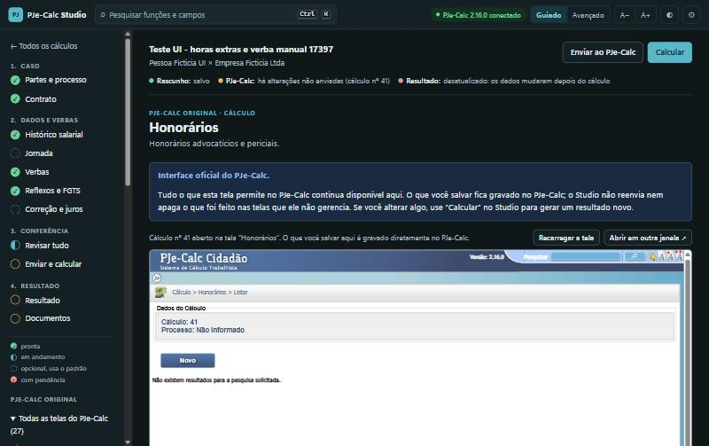

# PJe-Calc Studio

Uma interface moderna, guiada e acessível para o **PJe-Calc Cidadão**, o programa oficial de cálculos da Justiça
do Trabalho.

O Studio organiza o preenchimento em etapas, explica cada campo, confere os dados antes do envio e opera as telas
oficiais do PJe-Calc por você. **Quem calcula continua sendo o PJe-Calc instalado no seu computador.** O Studio
não faz conta nenhuma: os valores do resultado vêm do relatório oficial e do arquivo `.PJC` gerados pelo próprio
PJe-Calc.

**[⬇️ Baixar o instalador para Windows](https://github.com/yarceygomes/pjecalc-studio/releases/latest/download/PJeCalcStudio-Instalador.exe)**
· [Todas as versões](https://github.com/yarceygomes/pjecalc-studio/releases) · Gratuito e de código aberto (MIT)

## Instalação

**Antes:** tenha o **PJe-Calc Cidadão** instalado pelo instalador oficial do seu tribunal. O Studio foi testado
com a versão 2.16.0.

1. **Baixe** o [PJeCalcStudio-Instalador.exe](https://github.com/yarceygomes/pjecalc-studio/releases/latest/download/PJeCalcStudio-Instalador.exe).
2. **Dê dois cliques** no arquivo baixado.
   Se aparecer a tela azul *"O Windows protegeu o computador"*, clique em **Mais informações** e depois em
   **Executar assim mesmo**. Esse aviso aparece em programas novos que ainda não têm um certificado pago de
   assinatura; o código do Studio está todo aqui, aberto para conferência.
3. Clique em **Avançar**, **Instalar** e **Concluir**. O Studio abre sozinho no navegador.

Pronto. A instalação não pede senha de administrador e já inclui tudo o que o Studio precisa: não é preciso
instalar Python nem mais nada.

## Uso no dia a dia

1. Abra o **PJe-Calc** pelo atalho oficial e espere a tela inicial aparecer.
2. Abra o **PJe-Calc Studio** pelo menu Iniciar (ou pelo atalho da Área de Trabalho). Ele abre no navegador, em
   `http://127.0.0.1:8765/`.
3. Crie um cálculo (em branco, a partir de um modelo, importando um `.PJC` ou trazendo um cálculo que já está no
   PJe-Calc) e siga as etapas. **Enviar ao PJe-Calc** preenche as telas oficiais; **Calcular** liquida e guarda o
   relatório oficial (HTML e PDF) e o `.PJC`.

O que não tem formulário próprio no Studio (faltas, férias, cartão de ponto, contribuição social, IR, honorários,
custas, pagamentos, tabelas…) fica em **Funções do PJe-Calc**, no menu lateral: é a própria tela do PJe-Calc,
aberta no cálculo certo e com todas as validações oficiais.

O passo a passo completo, com exemplos, abre pelo atalho **Como usar o PJe-Calc Studio** no menu Iniciar.

## Atualizações

Quando sai uma versão nova, o Studio avisa no topo da tela. Em **Configurações › Atualizações**, um clique baixa
a versão nova, confere o arquivo, instala e reabre o Studio. Os seus cálculos não são tocados.

## Seus dados

- Tudo roda no seu computador (`127.0.0.1`). Sem assistente de IA, nenhum dado sai da sua máquina.
- Os cálculos ficam em `%LOCALAPPDATA%\PJeCalcStudio\dados`, fora da pasta do programa: atualizar ou desinstalar
  o Studio **não** apaga nenhum cálculo.
- Faça cópias de segurança em **Configurações › Criar cópia de segurança**.
- A única conexão com a internet é a consulta de versão nova a este repositório no GitHub.

## Assistentes Claude e Codex (opcional)

O Claude (Claude Desktop ou Claude Code) e o Codex podem operar o Studio por você: você entrega a sentença e o
assistente cria o cálculo, preenche as etapas e as telas do PJe-Calc, calcula e confere o resultado com o
documento. Configure em **Assistentes Claude e Codex**, no menu do Studio. Cada assistente usa a sua própria conta;
o Studio não pede nem guarda senha ou chave de IA.

> **Sigilo:** ao usar um assistente, o conteúdo dos cálculos que ele ler (nomes, documentos, salários, trechos de
> decisões) é enviado ao fornecedor pela sua conta: Anthropic no Claude, OpenAI no Codex.

## Desinstalar

**Configurações do Windows › Aplicativos › PJe-Calc Studio › Desinstalar.** Os cálculos continuam em
`%LOCALAPPDATA%\PJeCalcStudio\dados`. Apague essa pasta só se não for mais precisar deles.

## Problemas comuns

| O que aparece | O que fazer |
|---|---|
| "PJe-Calc desconectado" | Abra o PJe-Calc pelo atalho oficial e espere a tela inicial. Em **Configurações**, o botão **Diagnóstico** testa a ligação. |
| A página do Studio não abre | Abra o PJe-Calc Studio pelo menu Iniciar de novo, ou acesse `http://127.0.0.1:8765/` no navegador. |
| "Versão do PJe-Calc não validada" | O Studio foi testado com o PJe-Calc 2.16.0. Em outras versões ele funciona, mas confira o resultado no relatório oficial. |
| Outro problema | Abra uma [issue](https://github.com/yarceygomes/pjecalc-studio/issues/new/choose) contando o que aconteceu. |

## Aviso

O PJe-Calc Studio é um projeto independente. Não é um produto oficial nem tem vínculo com o CSJT, o TST ou os
Tribunais Regionais do Trabalho. O resultado oficial é sempre o do PJe-Calc: confira o relatório gerado por ele
antes de usar um cálculo em qualquer processo.

## Para desenvolvedores

Código, arquitetura, testes e como gerar o instalador: [docs/DESENVOLVIMENTO.md](docs/DESENVOLVIMENTO.md).
Publicar uma versão nova: [PUBLICAR.md](PUBLICAR.md).

Licença [MIT](LICENSE).
